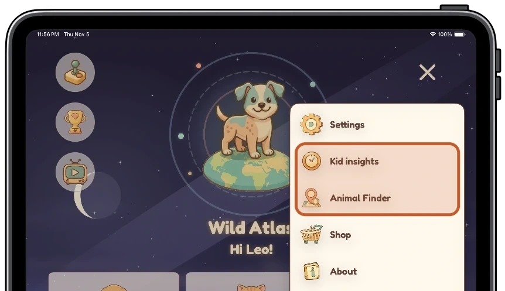
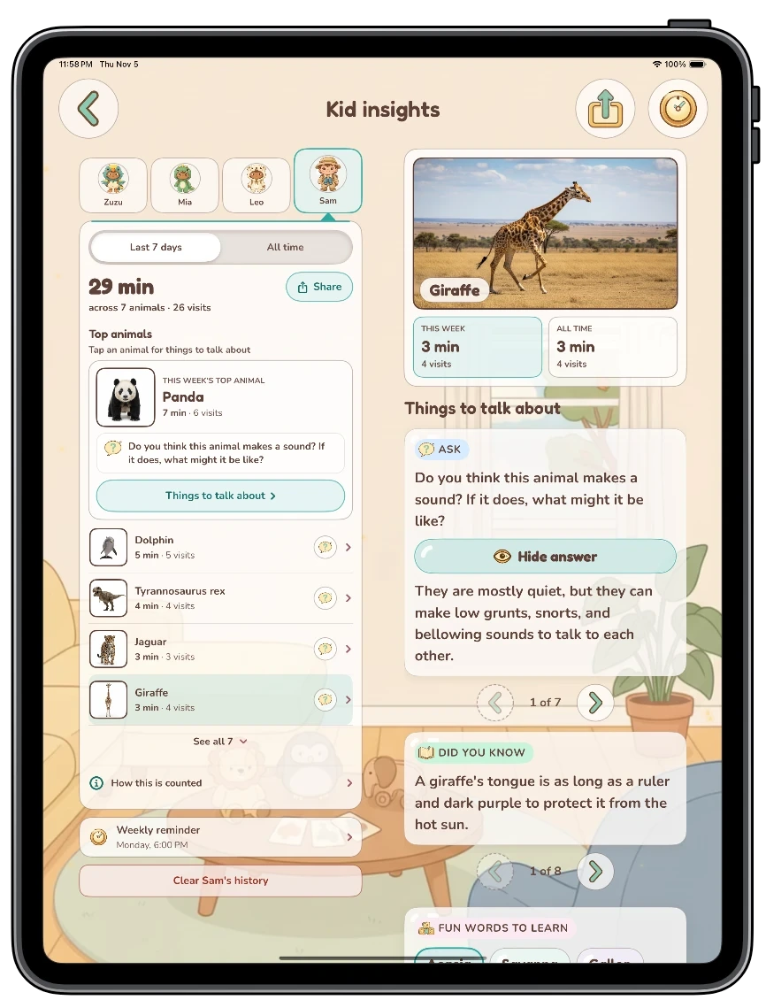
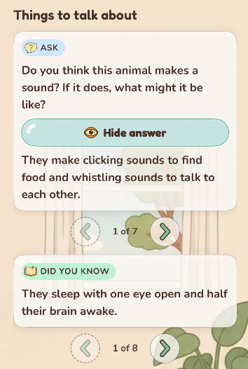
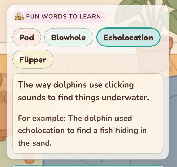
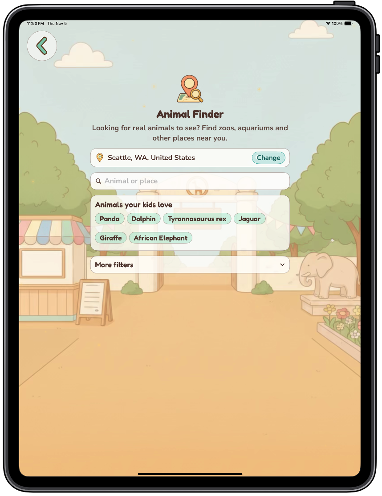
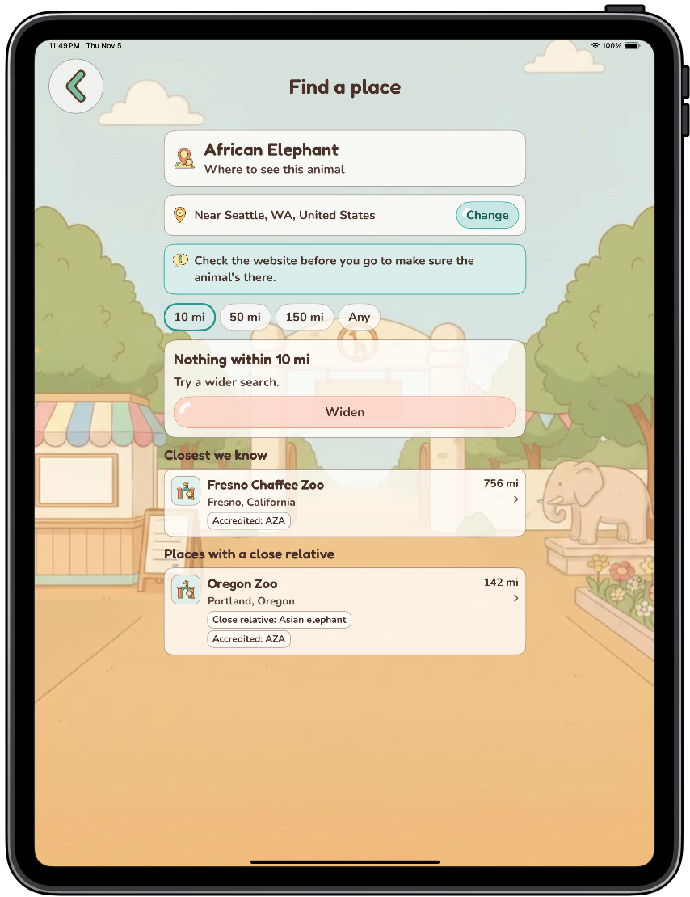

<!-- VERSION: TBD. The post says "the next update" everywhere; fill in the version Roger ships. Needs the final-build screenshots, the sample numbers, and the starters build check (see PENDING-BUILD) before it can leave draft. -->

A lot of you asked how to explore Wild Atlas with your kid, and turn app time into conversation. In the next update, Kid insights and the Animal Finder, in the grown-ups area (the burger menu on Home), show which animals your kids spend time with, give conversation starters, and find places nearby in real life. This release is for you.

## Wild Atlas 2.1 Walkthrough

<video controls playsinline preload="metadata" poster="/assets/blog/kid-insights-new-features-poster.jpg" aria-label="Walkthrough video of Kid insights and the Animal Finder, with narration" style="width:100%;max-width:420px;height:auto;aspect-ratio:9/16;display:block;margin:0 auto;border-radius:12px;background:#fff8ec"><source src="/assets/blog/kid-insights-new-features.mp4" type="video/mp4">Your browser does not support the video tag. <a href="/assets/blog/kid-insights-new-features.mp4">Download the walkthrough video (MP4)</a>.</video>

<!-- VERSION: TBD -->

<!-- PENDING-BUILD NOTE: the opening, excerpt and TL;DR mention conversation starters; trim that mention if the starters section is cut. -->

## Kid insights: what it shows

Pick a child, from up to four, then Last 7 days or All time, and you'll see total time with animals, how many animals and visits, and a Top animals list. In the screen below, Sam's week: 29 minutes across 7 animals, with the Panda on top.

<!-- Josh's iPad capture, 2026-11-05 (new build, sample child Sam). -->
<!-- Josh's iPad capture, 2026-11-05. BEFORE PUBLISH: this capture shows the Debug row at the bottom of the menu (debug build only). Replace with a capture that hides it, or retouch with Josh's OK. -->

  <figure><figcaption>The grown-ups menu on Home</figcaption></figure>
  <figure><figcaption>Kid insights, with an animal opened beside the list</figcaption></figure>

Tap an animal in the list, and you get things to talk about for it, right there.

You can set up a reminder once a week that will tell you which animals your kids have been into. You pick the day and time.

<!-- PENDING-BUILD: starters + Words to learn; delete this section if the build slips -->
## Conversation Starters

In Kid insights, tap an animal your kids spent time with, and you'll have something to talk about. The in-app label is "Things to talk about," and it pairs a question to ask out loud with a Did you know line and three quick facts about that animal. Right next to it, Fun Words to Learn shows four word chips from that animal; tap one and it shows you what it means.

<!-- Josh's captures, 2026-11-06 (new build, Dolphin). -->

  <figure><figcaption>Things to talk about</figcaption></figure>
  <figure><figcaption>Fun Words to Learn</figcaption></figure>

It works in the car, at dinner, or at bedtime: ask the question on the card, then let your child tell you the rest.
<!-- /PENDING-BUILD -->

## Find a Place to See the Animal IRL

There are two ways in: the Animal Finder, in the grown-ups area, where you can search for an animal or a place, or tap one of "Animals your kids love"; or "Where to see this animal" when you open an animal in Kid insights. Either way, Wild Atlas shows nearby zoos, aquariums, and other places, each behind a parent check to open in Maps, share, or visit the website. If none nearby has that exact animal, it shows places with a close relative. Check the website before you go to make sure the animal's there.

<!-- Josh's iPad captures, 2026-11-05 (new build). -->

  <figure><figcaption>Animal Finder</figcaption></figure>
  <figure><figcaption>Find a place, for one animal</figcaption></figure>

## What stays on your phone, and what doesn't

- Your child's play history stays on this device unless you share it, and you can clear it anytime.
- The weekly reminder is made on your phone; nothing about your explorers is sent to set it up. It shows your kids' names and top animals unless you switch that off, and anyone who can see your lock screen can read it.
- Find a place sends what you type to Apple, not to Wild Atlas, and fetches a small public file for the animal from wildatlasapp.com, which is why it needs a connection.

No ads, no accounts, in Kid insights or anywhere else in Wild Atlas.

## Where to find it

Kid insights lands in the grown-ups area in the next update.

*Raise explorers, not scrollers.*
